# 🔨 Apache Maven — Complete Notes

> **Module:** `01-maven` · **Repo:** [Advanced-java](https://github.com/nishanth-1431/Advanced-java)
> **Primary reference:** Telusko — Advanced Java Full Course (Build Tools & Testing section)
> **Follows:** [`SYLLABUS.md`](SYLLABUS.md) section by section · **Practice order:** [`LEARNING-PLAN.md`](LEARNING-PLAN.md)
> **Platform used in examples:** Windows (EC2 notes marked *optional*)

All diagrams are written in **Mermaid** or plain ASCII, so they render directly on GitHub — no images to upload.

---

## 📑 Table of Contents

| # | Syllabus section | Topics |
|---|---|---|
| 1 | [Maven fundamentals](#1-maven-fundamentals) | Introduction · Installation (Windows / EC2) · First project · Terminologies · Goals |
| 2 | [Project configuration & structure](#2-project-configuration--structure) | Web application · `pom.xml` · Effective POM · IntelliJ · Eclipse |
| 3 | [Dependencies & repositories](#3-dependencies--repositories) | Dependencies · Scopes · Transitive deps · Repositories |
| 4 | [Build lifecycle & plugins](#4-build-lifecycle--plugins) | Lifecycles · Phases · Goals ↔ lifecycle · Plugins · Build commands |
| 5 | [Testing](#5-testing) | Sample test project · Surefire · JUnit |
| 6 | [Framework & tool comparison](#6-framework--tool-comparison) | Spring Boot with Maven · Gradle |
| 7 | [Quick reference](#7-quick-reference) | Cheat sheet · Errors & fixes · Interview Qs · Revision checklist |

---

## 🧭 Big Picture First (read this before anything else)

Maven is a **build automation and dependency management tool**. You *describe* your project in one file (`pom.xml`), and Maven *does* the repetitive work: download libraries, compile, test, package, install.

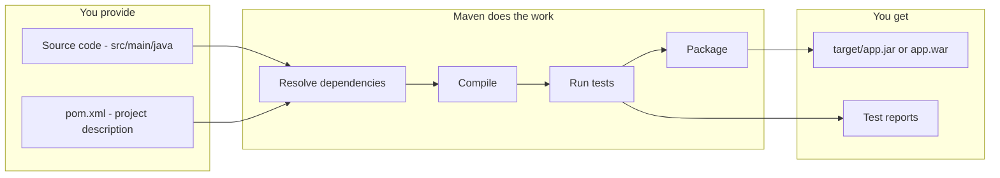

**Recommended learning order** (from `LEARNING-PLAN.md`): the course video introduces some topics before their prerequisites, so in practice go:

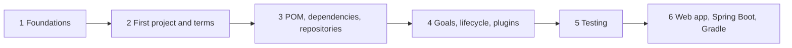

---

# 1. Maven Fundamentals

## 1.1 Introduction to Maven

### Definition
**Apache Maven** is an open-source build automation and project management tool for Java projects. It uses a declarative XML file, `pom.xml` (**P**roject **O**bject **M**odel), to describe *what* the project is, and uses plugins to decide *how* to build it.

### Why it matters — the problem it solves
Without a build tool, every developer repeats the same manual steps and the project only works "on my machine".

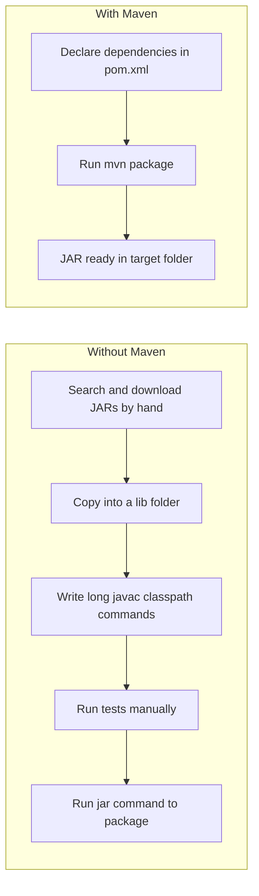

| Problem without a build tool | How Maven solves it |
|---|---|
| Manually downloading JARs and their dependencies | **Dependency management** — declare once, Maven downloads (including transitive deps) |
| Different folder layouts in every project | **Convention over configuration** — standard directory layout |
| Long compile / test / package commands | **Lifecycle** — one command (`mvn package`) runs every step in order |
| "Works on my machine" | Same `pom.xml` gives the same build for everyone |
| Hard to plug into CI/CD | Every CI tool (Jenkins, GitHub Actions) understands Maven |

### What Maven automates
Compiling · Testing · Packaging (JAR/WAR) · Dependency resolution · Installing artifacts locally · Deploying to remote repos · Generating reports/site docs.

### Core ideas (remember these four)
1. **Convention over configuration** — follow the standard layout and you need almost no config.
2. **Declarative** — you say *what* (dependencies, Java version), not *how*.
3. **Plugin-based** — Maven core is tiny; plugins do all the real work (compile, test, jar...).
4. **Repository-based** — libraries live in repositories, identified by coordinates.

### Maven vs JDK (common confusion)

| | JDK | Maven |
|---|---|---|
| What is it | Java Development Kit — compiler (`javac`), runtime (`java`), tools | A Java program that *orchestrates* the JDK tools |
| Needed to run Java code? | Yes | No |
| Needed to run Maven? | **Yes — Maven itself runs on Java** | — |

```
 ┌────────────────────────────┐
 │  Maven  (mvn)              │   ← decides WHAT to run and in WHAT order
 ├────────────────────────────┤
 │  Maven plugins             │   ← compiler plugin calls javac, jar plugin packages...
 ├────────────────────────────┤
 │  JDK  (javac, java, jar)   │   ← does the actual Java work
 ├────────────────────────────┤
 │  Operating System          │
 └────────────────────────────┘
```

### What happens when you run a Maven command

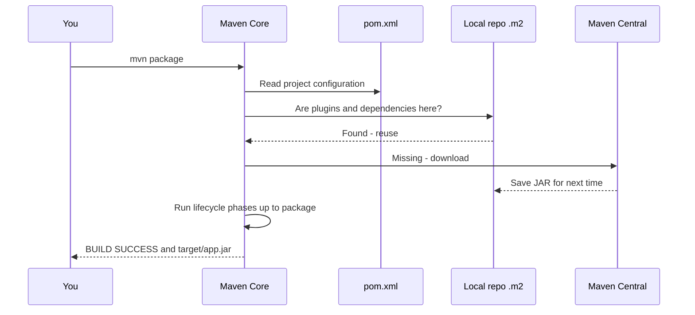

### ✍️ Try it
- In your own words: why can't Maven replace the JDK?
- List 3 things you'd have to do manually if Maven didn't exist.

### 🎯 Interview questions
1. What is Maven and why do we use it?
2. What does "convention over configuration" mean in Maven?
3. Is Maven a replacement for the JDK? Explain.
4. What does POM stand for?

---

## 1.2 Installation of Maven

### Pre-requisites
- JDK installed (Java 8 or newer for Maven 3.9.x — check the [download page](https://maven.apache.org/download.cgi) for the latest requirement).
- `JAVA_HOME` environment variable pointing to the **JDK folder** (not the `bin` folder, and not a JRE).

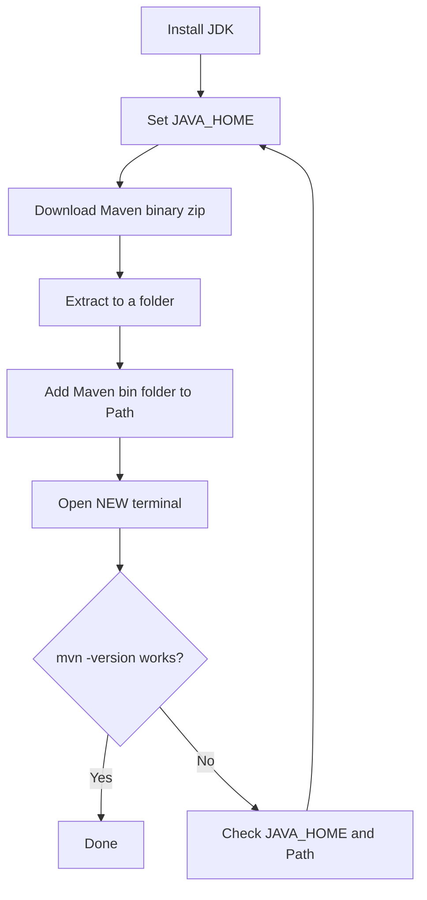

### 1.2.1 Installation on Windows

1. **Verify Java** — open Command Prompt:
   ```bat
   java -version
   javac -version
   echo %JAVA_HOME%
   ```
   `javac` must work. If `echo %JAVA_HOME%` prints `%JAVA_HOME%`, it is not set.

2. **Set `JAVA_HOME`** — *Start → "Edit the system environment variables" → Environment Variables → New (System variable)*
   - Name: `JAVA_HOME`
   - Value: `C:\Program Files\Java\jdk-xx` *(your JDK install folder)*

3. **Download Maven** — from `maven.apache.org/download.cgi`, get the **Binary zip archive** (`apache-maven-3.9.x-bin.zip`).

4. **Extract** to a simple path, e.g. `C:\Program Files\Apache\maven` or `C:\maven`.

5. **Add to Path** — *Environment Variables → Path → Edit → New* → `C:\maven\bin` (the `bin` folder inside the extracted Maven).
   *(Optional: also create `MAVEN_HOME` = `C:\maven` and use `%MAVEN_HOME%\bin` in Path.)*

6. **Open a NEW terminal** (old terminals keep old variables) and verify:
   ```bat
   mvn -version
   ```
   Expected output includes: Apache Maven version, Maven home, Java version, Java home, OS name.

**Record in your notes:** Maven version = `____` · Java version = `____` · Maven home = `____`

### 1.2.2 Installation on AWS EC2 *(optional deployment/environment topic)*

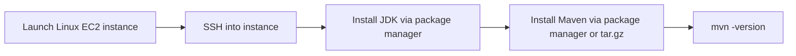
Do this **after** local Maven is comfortable. Package-manager versions are often older than the latest Maven, so check `mvn -version` after installing.

### 🧰 Errors & fixes

| Error | Cause | Fix |
|---|---|---|
| `'mvn' is not recognized as an internal or external command` | Maven `bin` not in Path, or terminal not restarted | Add `...\maven\bin` to Path, open a new terminal |
| `The JAVA_HOME environment variable is not defined correctly` | Wrong or missing `JAVA_HOME` | Point it to the JDK root folder (contains `bin`, `lib`) — no trailing `\bin` |
| `No compiler is provided in this environment` | Using a JRE instead of a JDK | Install a JDK and update `JAVA_HOME` |

### 🎯 Interview questions
1. Why does Maven need `JAVA_HOME`?
2. Which folder do you add to the Path — Maven root or Maven `bin`?
3. How do you check the Maven and Java versions in use?

---

## 1.3 Create a Simple Java Project using Maven (Windows)

Two ways: **(a)** command line using an *archetype* (a project template), **(b)** through an IDE (see §2.4 and §2.5).

### Using the quickstart archetype

```bat
mvn archetype:generate ^
  -DgroupId=com.nishanth ^
  -DartifactId=maven-demo ^
  -DarchetypeArtifactId=maven-archetype-quickstart ^
  -DinteractiveMode=false
```
*(In PowerShell use the backtick `` ` `` instead of `^` for line breaks, or write it on one line.)*

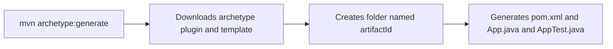

### Generated structure (standard directory layout)

```
maven-demo/
├── pom.xml                         ← project description (the heart of Maven)
└── src/
    ├── main/
    │   ├── java/                   ← application source code
    │   │   └── com/nishanth/App.java
    │   └── resources/              ← config files, properties (copied to the output)
    └── test/
        ├── java/                   ← test source code
        │   └── com/nishanth/AppTest.java
        └── resources/              ← test-only resources

(after you build)
target/                             ← ALL generated output (safe to delete: mvn clean)
├── classes/                        ← compiled main classes
├── test-classes/                   ← compiled test classes
├── surefire-reports/               ← test reports
└── maven-demo-1.0-SNAPSHOT.jar     ← the packaged artifact
```

| Path | Purpose |
|---|---|
| `pom.xml` | Project config: coordinates, dependencies, plugins, properties |
| `src/main/java` | Production code |
| `src/main/resources` | Production resources (`application.properties`, XML, etc.) |
| `src/test/java` | Test code — **never packaged** into the final artifact |
| `src/test/resources` | Test-only resources |
| `target/` | Build output — never commit it (add to `.gitignore`) |

### Build and run

```bat
cd maven-demo
mvn clean package
java -cp target\classes com.nishanth.App
```
`java -cp target\classes ...` runs from compiled classes. Running `java -jar target\maven-demo-1.0-SNAPSHOT.jar` only works if the JAR manifest has a `Main-Class` (the quickstart doesn't set it by default — a good observation to record and fix later with the JAR plugin).

### Create the same project on AWS EC2 *(optional practice)*
Same `mvn archetype:generate` command works on Linux — only the shell syntax differs (`\` instead of `^`).

### ✍️ Try it (do this yourself, then record in `basics/`)
1. Generate a project with your own `groupId`/`artifactId`.
2. Open `App.java`, change the output text, rebuild, run.
3. Delete `target/` and rebuild — what is recreated?
4. Note every file Maven generated and what it does.

### 🎯 Interview questions
1. What is an archetype?
2. What is the standard Maven directory layout? Why does it matter?
3. Where does the compiled output go?

---

## 1.4 Maven Terminologies

### Coordinates (GAV) — the unique address of every artifact

```
                    ┌────────────────────────────────────────┐
  Maven Central     │  groupId     :  org.junit.jupiter      │   WHO made it
  (a giant library) │  artifactId  :  junit-jupiter          │   WHAT it is
                    │  version     :  5.10.2                 │   WHICH release
                    │  packaging   :  jar  (default)         │   FORMAT
                    └────────────────────────────────────────┘
                    →  stored at  org/junit/jupiter/junit-jupiter/5.10.2/junit-jupiter-5.10.2.jar
```

| Element | Meaning | Convention |
|---|---|---|
| `groupId` | Organisation / project group | Reverse domain: `com.company.project` |
| `artifactId` | Name of this project/module | lowercase, hyphen-separated |
| `version` | Release number | `1.0.0`; `-SNAPSHOT` = still in development |
| `packaging` | Output type | `jar` (default), `war`, `pom`, `ear` |

**SNAPSHOT vs release:** `1.0-SNAPSHOT` means "work in progress, may change any time"; `1.0` is a fixed release that should never change.

### The terminology map

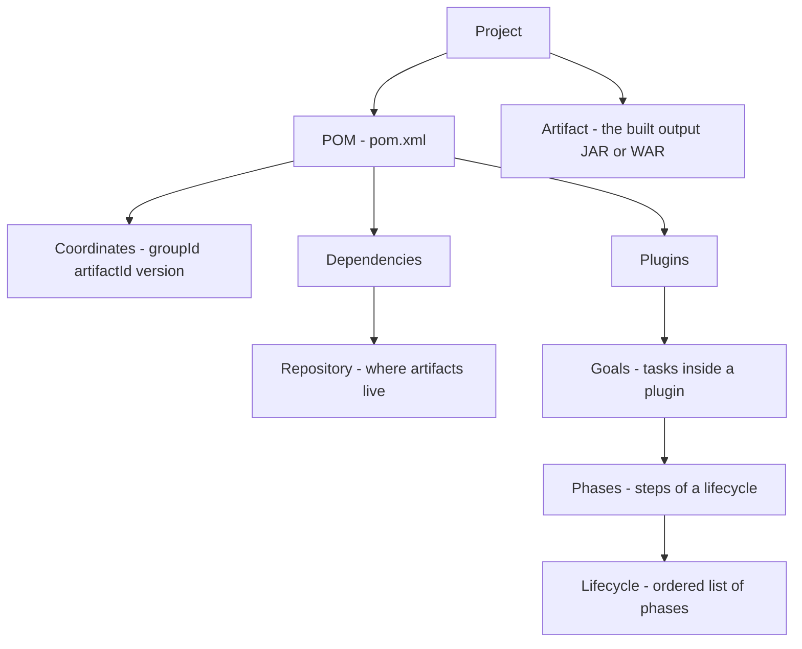

| Term | Plain-English meaning |
|---|---|
| **Project** | Your application — one folder with a `pom.xml` |
| **POM** | `pom.xml`, the XML description of the project |
| **Artifact** | Anything Maven produces or consumes: a JAR, WAR, POM. Identified by coordinates |
| **Coordinates** | `groupId` + `artifactId` + `version` (+ `packaging`) |
| **Repository** | A storage location for artifacts: local, central, remote/private |
| **Dependency** | An artifact your project needs (e.g. JUnit, Spring) |
| **Plugin** | A tool that contains goals (compiler, surefire, jar...) |
| **Goal** | A single task inside a plugin, written `plugin:goal` (e.g. `compiler:compile`) |
| **Phase** | A named step in a lifecycle (e.g. `compile`, `test`, `package`) |
| **Lifecycle** | An ordered sequence of phases (`clean`, `default`, `site`) |
| **Archetype** | A project template used to generate new projects |
| **Module** | A sub-project in a multi-module build |

### 🎯 Interview questions
1. What are Maven coordinates?
2. Difference between `groupId` and `artifactId`?
3. What is a SNAPSHOT version?
4. Difference between an artifact and a dependency?

---

## 1.5 Maven Goals

### Definition
A **goal** is a specific task, packaged inside a **plugin**. Written as `pluginName:goalName`.

```
   mvn  compiler : compile
   ───  ────────   ───────
    │      │          └── goal (the task)
    │      └───────────── plugin (the toolbox)
    └──────────────────── Maven command
```

### Examples

| Command | Meaning |
|---|---|
| `mvn compiler:compile` | Run only the `compile` goal of the compiler plugin |
| `mvn surefire:test` | Run only the test goal |
| `mvn archetype:generate` | Generate a project from a template |
| `mvn dependency:tree` | Print the dependency tree |
| `mvn help:effective-pom` | Print the final merged POM |
| `mvn clean:clean` | Delete the `target` folder |

### Goal vs Phase (very commonly asked)

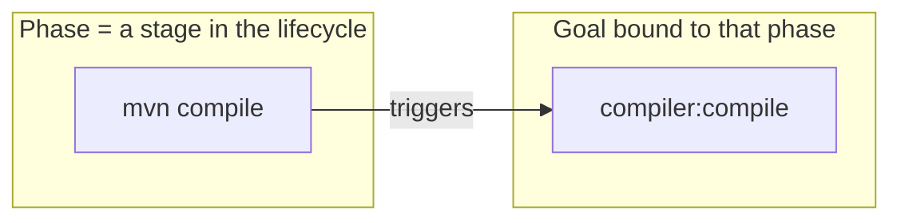

| | Goal | Phase |
|---|---|---|
| Belongs to | A plugin | A lifecycle |
| Example | `compiler:compile` | `compile` |
| Runs | Only itself | **All earlier phases first**, then its own goals |
| Command | `mvn plugin:goal` | `mvn phase` |

Full lifecycle coverage is in [§4](#4-build-lifecycle--plugins).

### 🎯 Interview questions
1. What is a Maven goal? Give 3 examples.
2. Difference between a goal and a phase?
3. How do you run a single goal?

---

# 2. Project Configuration & Structure

## 2.1 Create a Web Application

### Definition
A Maven **web application** is a project with `packaging` = `war` (Web ARchive), containing servlets/JSP/static files, deployed to a servlet container such as **Tomcat**.

```bat
mvn archetype:generate ^
  -DgroupId=com.nishanth ^
  -DartifactId=maven-web-demo ^
  -DarchetypeArtifactId=maven-archetype-webapp ^
  -DinteractiveMode=false
```

### Structure

```
maven-web-demo/
├── pom.xml                          ← <packaging>war</packaging>
└── src/
    └── main/
        ├── java/                    ← servlets and Java code (create if missing)
        ├── resources/               ← config files (create if missing)
        └── webapp/                  ← web root — what the browser sees
            ├── index.jsp
            └── WEB-INF/             ← protected, not directly accessible
                └── web.xml          ← deployment descriptor
```

### JAR vs WAR

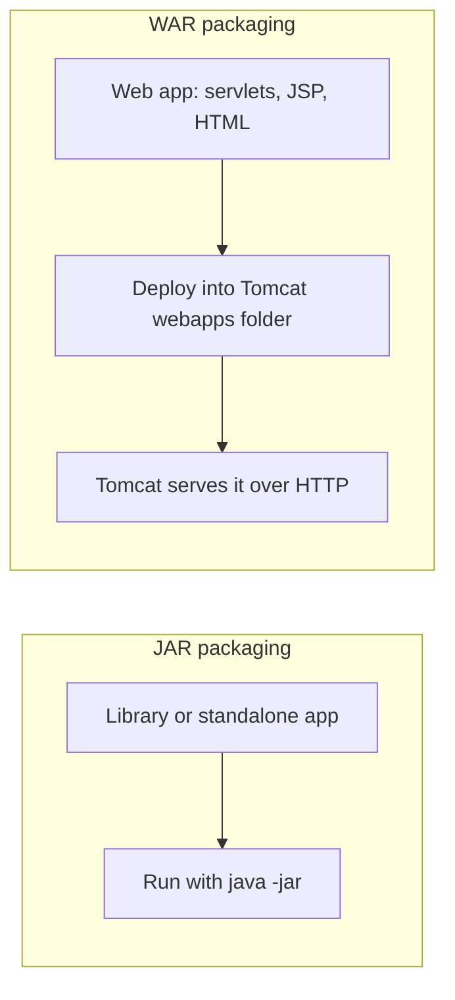

### High-level WAR flow

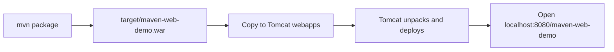

**Notes**
- The Servlet API is needed to compile but is already provided by Tomcat at runtime → it uses **`provided`** scope (see §3).
- Tomcat 9 uses `javax.servlet.*`; Tomcat 10+ uses `jakarta.servlet.*` — match your dependency to your Tomcat version.
- Servlets/JSP are covered in detail in `05-servlets` and `06-jsp`; here you only need to understand the packaging and structure.

### 🎯 Interview questions
1. Difference between JAR and WAR?
2. Where does `web.xml` live? What is `WEB-INF` for?
3. Why is the servlet API `provided` scope?

---

## 2.2 `pom.xml`

### Definition
The **POM** is the single XML file that describes the project — identity, dependencies, build configuration, plugins.

### Anatomy of a basic `pom.xml`

```xml
<project xmlns="http://maven.apache.org/POM/4.0.0"
         xmlns:xsi="http://www.w3.org/2001/XMLSchema-instance"
         xsi:schemaLocation="http://maven.apache.org/POM/4.0.0
                             http://maven.apache.org/xsd/maven-4.0.0.xsd">

  <modelVersion>4.0.0</modelVersion>          <!-- POM format version; always 4.0.0 -->

  <!-- 1. COORDINATES: who am I? -->
  <groupId>com.nishanth</groupId>
  <artifactId>maven-demo</artifactId>
  <version>1.0-SNAPSHOT</version>
  <packaging>jar</packaging>

  <name>maven-demo</name>                     <!-- human-friendly name -->

  <!-- 2. PROPERTIES: reusable values and settings -->
  <properties>
    <maven.compiler.release>17</maven.compiler.release>
    <project.build.sourceEncoding>UTF-8</project.build.sourceEncoding>
  </properties>

  <!-- 3. DEPENDENCIES: libraries I need -->
  <dependencies>
    <!-- <dependency> blocks go here -->
  </dependencies>

  <!-- 4. BUILD: plugins and build settings -->
  <build>
    <plugins>
      <!-- <plugin> blocks go here -->
    </plugins>
  </build>
</project>
```

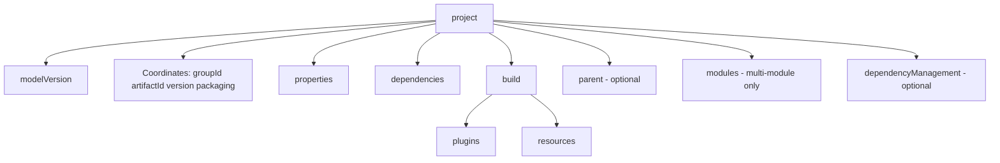

### Properties and Java compiler configuration

| Property | Meaning |
|---|---|
| `maven.compiler.release` | Java version to compile *for* (recommended — checks the API too). Needs Java 9+ |
| `maven.compiler.source` / `maven.compiler.target` | Older style: source level / bytecode level |
| `project.build.sourceEncoding` | Source file encoding — set to `UTF-8` |

**Use your own properties** to avoid repeating values:
```xml
<properties>
  <junit.version>5.10.2</junit.version>
</properties>
...
<version>${junit.version}</version>
```
Built-in properties: `${project.version}`, `${project.artifactId}`, `${project.basedir}`, `${project.build.directory}`.

### Inheritance — the Super POM
Every POM implicitly inherits from Maven's built-in **Super POM**, which defines defaults (repositories, `target/` as output dir, default plugin versions...). You can also declare your own `<parent>` (Spring Boot does this).

### ✍️ Try it
- Add `maven.compiler.release` to your project and change the value to something your JDK doesn't support. Read the error.
- Define one property and reuse it with `${...}`.

### 🎯 Interview questions
1. What is the Super POM?
2. What are the mandatory elements of a POM? *(modelVersion, groupId, artifactId, version)*
3. How do you set the Java version in Maven?
4. What is `packaging` and what is its default?

---

## 2.3 Effective POM

### Definition
The **effective POM** is the *final, fully-merged* POM that Maven actually uses — your `pom.xml` **plus** everything inherited and injected.

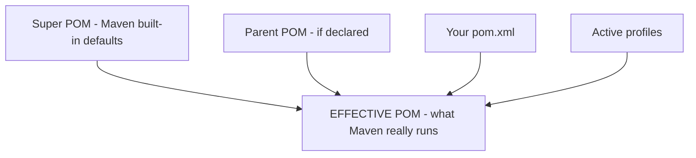

```bat
mvn help:effective-pom
mvn help:effective-pom -Doutput=effective-pom.xml
```

**Why it matters:** your tiny POM may be 30 lines but the effective POM is hundreds. It tells you which plugin versions are used, where repositories come from, and where a mystery setting originated. It is the #1 debugging tool for "why is Maven doing this?".

### ✍️ Try it
Generate it, then find: (1) default `sourceDirectory`, (2) the compiler plugin version, (3) the Central repository URL.

### 🎯 Interview questions
1. What is the effective POM and how do you view it?
2. What feeds into the effective POM?

---

## 2.4 Create a Maven Project using IntelliJ IDEA

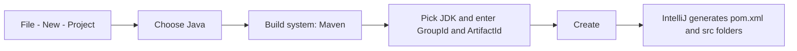

- **Maven tool window** (right side) shows Lifecycle phases, Plugins, and Dependencies → double-click a phase to run it.
- After editing `pom.xml`, click **"Load Maven Changes"** (the small `m` icon) so the IDE re-reads dependencies.
- IntelliJ bundles its own Maven. To use the one you installed: *Settings → Build, Execution, Deployment → Build Tools → Maven → Maven home path*.
- Check *Project Structure → SDK* matches `maven.compiler.release`.

## 2.5 Create a Maven Project using Eclipse IDE *(optional if not using Eclipse)*

- *File → New → Maven Project → (tick "Create a simple project" or choose an archetype) → enter coordinates → Finish.*
- After editing `pom.xml` externally: right-click project → **Maven → Update Project** (`Alt+F5`).
- Run builds with *Run As → Maven build...* and enter goals (e.g. `clean package`).

> **Scope note (from syllabus):** use the IDE you actually work with first — learning both is optional.

### 🎯 Interview questions
1. Why must you "reload" Maven after editing `pom.xml` in an IDE?
2. Does the IDE build replace `mvn` on the command line? *(No — CI servers use the command line, so always know both.)*

---

# 3. Dependencies & Repositories

> In the course video, dependencies appear before `pom.xml`. In these notes `pom.xml` (§2.2) comes first, because dependencies are written *inside* it.

## 3.1 Maven Dependencies

### Definition
A **dependency** is an external artifact (usually a JAR) your project needs. You declare its coordinates; Maven downloads it and puts it on the classpath.

### Adding a dependency

```xml
<dependencies>
  <dependency>
    <groupId>org.junit.jupiter</groupId>
    <artifactId>junit-jupiter</artifactId>
    <version>5.10.2</version>
    <scope>test</scope>
  </dependency>
</dependencies>
```
> Versions here are examples — look up the current version on [search.maven.org](https://central.sonatype.com/) or [mvnrepository.com](https://mvnrepository.com/) when you write your own.

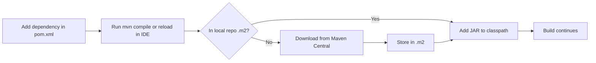

### Dependency scopes

| Scope | Compile classpath | Test classpath | Runtime classpath | Packaged in WAR/fat JAR | Typical example |
|---|:-:|:-:|:-:|:-:|---|
| `compile` *(default)* | ✅ | ✅ | ✅ | ✅ | Spring, Jackson, Gson |
| `provided` | ✅ | ✅ | ❌ | ❌ | Servlet API (Tomcat provides it) |
| `runtime` | ❌ | ✅ | ✅ | ✅ | JDBC driver (MySQL, PostgreSQL) |
| `test` | ❌ | ✅ | ❌ | ❌ | JUnit, Mockito |
| `system` | ✅ | ✅ | ❌ | ❌ | Local JAR via `systemPath` — **avoid**, deprecated |
| `import` | — | — | — | — | Only inside `dependencyManagement` with `<type>pom</type>` (BOMs) |

**Memory trick:** *"Do I need it to compile? to run? only to test? or will the server supply it?"*

### Transitive dependencies
If **A** needs **B**, and **B** needs **C**, Maven automatically brings **C** into **A** — you never declare C.


```bat
mvn dependency:tree
```
Sample output shape:
```
com.nishanth:maven-demo:jar:1.0-SNAPSHOT
\- library-b:jar:2.0:compile
   \- library-c:jar:1.5:compile       ← came in transitively
```

**Conflicts — "nearest definition wins":** if two paths ask for different versions of the same library, Maven picks the version **closest to your project in the tree**; on a tie, the **first declared** wins. To force a version, declare it directly in your POM.

**Exclusions** — remove an unwanted transitive dependency:
```xml
<dependency>
  <groupId>some.group</groupId>
  <artifactId>library-b</artifactId>
  <version>2.0</version>
  <exclusions>
    <exclusion>
      <groupId>unwanted.group</groupId>
      <artifactId>library-c</artifactId>
    </exclusion>
  </exclusions>
</dependency>
```

**`dependencyManagement`** — centralise versions (parent/multi-module). It *declares versions only*; modules still must list the dependency (without a version) to actually use it.

### ✍️ Try it
1. Add one external dependency (e.g. a small utility library), build, and open `.m2` to find its JAR.
2. Run `mvn dependency:tree` and identify one transitive dependency.
3. Change a scope and observe what breaks (e.g. use a `test`-scoped library in `src/main`).

### 🎯 Interview questions
1. What is a transitive dependency?
2. Explain Maven dependency scopes.
3. How does Maven resolve version conflicts?
4. Difference between `dependencies` and `dependencyManagement`?
5. How do you exclude a transitive dependency?

---

## 3.2 Maven Repositories

### Definition
A **repository** is a place where Maven stores and finds artifacts (JARs, POMs, plugins).

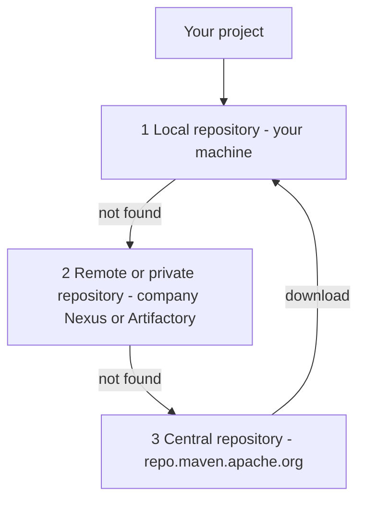

| Repository | Where | Purpose |
|---|---|---|
| **Local** | `C:\Users\<you>\.m2\repository` (Windows) · `~/.m2/repository` (Linux/Mac) | Cache of everything downloaded + your own `mvn install` artifacts |
| **Central** | `https://repo.maven.apache.org/maven2` | Default public repo — built into the Super POM |
| **Remote / Private** | Company server (Nexus, Artifactory, GitHub Packages) | Internal libraries and proxies |

### Local repository layout
It mirrors coordinates as folders:
```
.m2/repository/
└── org/junit/jupiter/junit-jupiter/5.10.2/
    ├── junit-jupiter-5.10.2.jar
    └── junit-jupiter-5.10.2.pom
```
`groupId` dots → folders, then `artifactId`, then `version`.

### Resolution order
**Local → (configured remote repos) → Central.** Once downloaded, Maven never downloads it again → builds work offline (`mvn -o`).

### Configuration files

| File | Location | Purpose |
|---|---|---|
| `settings.xml` (global) | `<maven>/conf/settings.xml` | Mirrors, proxy, local repo path for all users |
| `settings.xml` (user) | `C:\Users\<you>\.m2\settings.xml` | Your own overrides, credentials |
| `pom.xml` `<repositories>` | project | Add an extra repo for this project |

### Useful commands
```bat
mvn install                       :: put your artifact into the local repo
mvn dependency:purge-local-repository   :: re-download this project's dependencies
mvn -U clean install              :: force update of snapshots/missing metadata
```

### 🎯 Interview questions
1. Types of Maven repositories?
2. Where is the local repository? Can you change it?
3. What happens when a dependency isn't in the local repo?
4. What does `mvn install` do with respect to repositories?

---

# 4. Build Lifecycle & Plugins

## 4.1 Maven Build Lifecycle

### Definition
A **lifecycle** is a fixed, ordered sequence of **phases**. Running a phase runs **every earlier phase in that lifecycle first**.

### The three built-in lifecycles

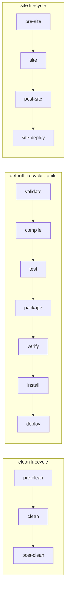

### The default lifecycle — main phases you must know

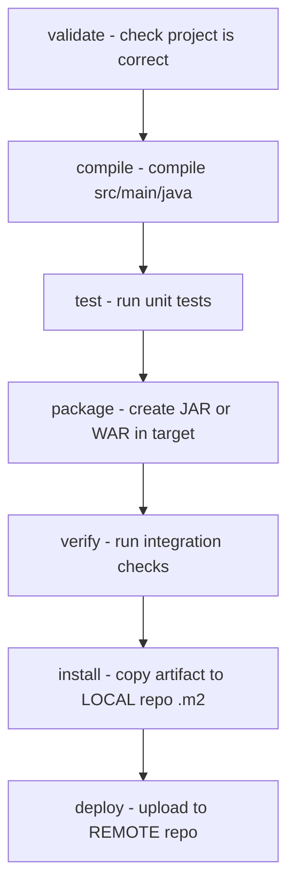

| Phase | What it does | Output |
|---|---|---|
| `validate` | Checks `pom.xml` is valid and info is available | — |
| `compile` | Compiles main source | `target/classes` |
| `test` | Compiles and runs unit tests (does **not** need to be packaged) | `target/surefire-reports` |
| `package` | Bundles into JAR/WAR | `target/*.jar` / `*.war` |
| `verify` | Runs checks on the package (integration tests, quality gates) | — |
| `install` | Installs the artifact to the **local** repo | `.m2/repository/...` |
| `deploy` | Copies to a **remote** repo for sharing | remote repo |
| `clean` *(clean lifecycle)* | Deletes `target/` | — |

*(The full default lifecycle has ~23 phases such as `process-resources`, `test-compile`, `prepare-package` — the ones above are the ones you run.)*

### Why does `mvn package` run earlier phases?
Because phases are **cumulative**: `package` needs compiled classes, and tests should pass before packaging. So Maven runs `validate → compile → test → package` automatically and stops. This is the **completion check** answer for Phase 4 in your plan.

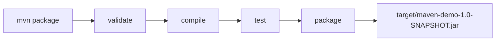

### Combining commands
```bat
mvn clean package        :: clean lifecycle first, then default up to package
mvn clean install        :: fresh build and install to .m2
mvn clean test           :: fresh compile + tests only
```
`clean` is in a **different** lifecycle — it does *not* run automatically before `package`, so you must write it.

### Common flags

| Flag | Meaning |
|---|---|
| `-DskipTests` | Compile tests but **don't run** them |
| `-Dmaven.test.skip=true` | **Skip compiling and running** tests |
| `-o` | Offline mode |
| `-X` | Debug output |
| `-q` | Quiet |
| `-U` | Force update snapshots |

---

## 4.2 Maven Goals and Lifecycle Relationship

**Phases are empty containers. Plugin goals are bound to them and do the actual work.**

```mermaid
flowchart LR
    subgraph PHASES["Lifecycle phases"]
        direction TB
        p1["process-resources"]
        p2["compile"]
        p3["test-compile"]
        p4["test"]
        p5["package"]
        p6["install"]
        p7["deploy"]
    end
    subgraph GOALS["Plugin goals bound by default - jar packaging"]
        direction TB
        g1["resources:resources"]
        g2["compiler:compile"]
        g3["compiler:testCompile"]
        g4["surefire:test"]
        g5["jar:jar"]
        g6["install:install"]
        g7["deploy:deploy"]
    end
    p1 --- g1
    p2 --- g2
    p3 --- g3
    p4 --- g4
    p5 --- g5
    p6 --- g6
    p7 --- g7
```

| Lifecycle phase | Plugin : goal that runs (jar packaging) |
|---|---|
| `clean` | `maven-clean-plugin : clean` |
| `process-resources` | `maven-resources-plugin : resources` |
| `compile` | `maven-compiler-plugin : compile` |
| `process-test-resources` | `maven-resources-plugin : testResources` |
| `test-compile` | `maven-compiler-plugin : testCompile` |
| `test` | `maven-surefire-plugin : test` |
| `package` | `maven-jar-plugin : jar` *(war packaging → `maven-war-plugin : war`)* |
| `install` | `maven-install-plugin : install` |
| `deploy` | `maven-deploy-plugin : deploy` |

**Key rule:** `mvn <phase>` = run a **phase** (and all before it). `mvn <plugin>:<goal>` = run exactly **one goal**, nothing before it.

### ✍️ Try it (Phase 4 practice list)
Run each of these in your project and note what appears in `target/` after each:
`mvn validate` → `mvn compile` → `mvn test` → `mvn package` → `mvn clean` → `mvn install`
Watch the console: lines like `--- compiler:3.x:compile (default-compile) ---` show **which plugin goal ran in which phase**.

---

## 4.3 Maven Plugins

### Definition
A **plugin** is a collection of goals. Maven core does almost nothing by itself — plugins do the work.

```mermaid
flowchart TD
    MC["Maven Core"] --> P1["maven-compiler-plugin"]
    MC --> P2["maven-surefire-plugin"]
    MC --> P3["maven-jar-plugin"]
    MC --> P4["maven-war-plugin"]
    MC --> P5["maven-clean-plugin"]
    MC --> P6["maven-install-plugin"]
    P1 --> G1["goals: compile, testCompile"]
    P2 --> G2["goals: test"]
    P3 --> G3["goals: jar"]
```

### Two kinds
- **Build plugins** — run during the build (compiler, surefire, jar, war).
- **Reporting plugins** — run during site generation (javadoc, surefire-report).

### Commonly used plugins

| Plugin | Purpose |
|---|---|
| `maven-compiler-plugin` | Compiles Java code (calls `javac`) |
| `maven-surefire-plugin` | Runs unit tests |
| `maven-failsafe-plugin` | Runs integration tests (`verify` phase) |
| `maven-jar-plugin` | Builds JARs (can set `Main-Class`) |
| `maven-war-plugin` | Builds WARs |
| `maven-clean-plugin` | Deletes `target/` |
| `maven-resources-plugin` | Copies resources |
| `maven-install-plugin` / `maven-deploy-plugin` | Install locally / deploy remotely |
| `maven-dependency-plugin` | `dependency:tree`, `dependency:copy-dependencies` |
| `exec-maven-plugin` | Run a Java class: `mvn exec:java -Dexec.mainClass=com.nishanth.App` |
| `spring-boot-maven-plugin` | Builds runnable Spring Boot JAR (§6.1) |

### Configuring a plugin in the POM
```xml
<build>
  <plugins>
    <plugin>
      <groupId>org.apache.maven.plugins</groupId>
      <artifactId>maven-jar-plugin</artifactId>
      <version>3.4.1</version>
      <configuration>
        <archive>
          <manifest>
            <mainClass>com.nishanth.App</mainClass>
          </manifest>
        </archive>
      </configuration>
    </plugin>
  </plugins>
</build>
```
Always pin plugin versions — otherwise Maven uses defaults from the Super POM that may be old.

### 🎯 Interview questions
1. What is a Maven plugin? Name five.
2. How are plugin goals attached to lifecycle phases?
3. How do you make an executable JAR with Maven?
4. Difference between Surefire and Failsafe?

---

## 4.4 Common Build Commands — Summary

| Command | What it does |
|---|---|
| `mvn validate` | Validate the project |
| `mvn compile` | Compile main code |
| `mvn test` | Compile + run unit tests |
| `mvn package` | Create JAR/WAR |
| `mvn verify` | Run verification/integration checks |
| `mvn install` | Install artifact in local repo |
| `mvn deploy` | Publish to remote repo |
| `mvn clean` | Delete `target/` |
| `mvn clean install` | Fresh build + install |

---

# 5. Testing

## 5.1 Sample Maven Project with a Test Case

### How testing fits in Maven

```mermaid
flowchart LR
    A["src/test/java - test classes"] --> B["test-compile phase"]
    B --> C["target/test-classes"]
    C --> D["test phase - Surefire plugin"]
    D --> E{"All tests pass?"}
    E -- Yes --> F["Build continues to package"]
    E -- No --> G["BUILD FAILURE - see surefire-reports"]
```

**Maven Surefire Plugin** = the plugin that discovers and runs unit tests in the `test` phase and writes reports.

**Default test discovery (class name patterns):** `Test*.java`, `*Test.java`, `*Tests.java`, `*TestCase.java` inside `src/test/java`.

### Add JUnit 5 to the POM
```xml
<dependencies>
  <dependency>
    <groupId>org.junit.jupiter</groupId>
    <artifactId>junit-jupiter</artifactId>
    <version>5.10.2</version>
    <scope>test</scope>        <!-- only needed for tests, not shipped -->
  </dependency>
</dependencies>

<build>
  <plugins>
    <plugin>
      <groupId>org.apache.maven.plugins</groupId>
      <artifactId>maven-surefire-plugin</artifactId>
      <version>3.2.5</version>   <!-- JUnit 5 needs Surefire 2.22+ -->
    </plugin>
  </plugins>
</build>
```

### Where to find test results

```
target/surefire-reports/
├── com.nishanth.AppTest.txt     ← quick readable summary (read this first)
└── TEST-com.nishanth.AppTest.xml ← detailed XML for CI tools
```
Console summary looks like: `Tests run: 3, Failures: 1, Errors: 0, Skipped: 0`
- **Failure** = an assertion failed (your logic is wrong).
- **Error** = an unexpected exception was thrown (code/setup problem).

### ✍️ Try it (Phase 5 practice list)
1. Create a small class (e.g. a `Calculator`) in `src/main/java`.
2. Write a test class for it in `src/test/java` (same package).
3. Run `mvn test` — read the passing output.
4. **Intentionally break** the code or the expected value → run again → open the failing report in `target/surefire-reports`.
5. Fix it, run `mvn test` again.

---

## 5.2 JUnit

### Definition
**JUnit** is the standard Java unit-testing framework. A *unit test* checks one small piece of code (a method) in isolation.

### JUnit 5 architecture
```
JUnit 5  =  JUnit Platform  +  JUnit Jupiter  +  JUnit Vintage
            (launcher, IDE      (new annotations     (runs old JUnit 3/4
             and build-tool      and API you write    tests)
             support)            tests with)
```
The `junit-jupiter` artifact pulls in everything you need to write JUnit 5 tests.

### Key annotations

| Annotation | Meaning |
|---|---|
| `@Test` | Marks a test method |
| `@BeforeEach` / `@AfterEach` | Runs before / after **every** test |
| `@BeforeAll` / `@AfterAll` | Runs once before / after **all** tests (methods must be `static`) |
| `@DisplayName("...")` | Readable test name in reports |
| `@Disabled` | Skip this test |

### Common assertions (`org.junit.jupiter.api.Assertions`)
`assertEquals(expected, actual)` · `assertNotEquals` · `assertTrue` · `assertFalse` · `assertNull` · `assertNotNull` · `assertThrows(Exception.class, () -> ...)`

### Test method shape — Arrange / Act / Assert
```
 Arrange  →  create the object and inputs
 Act      →  call the method under test
 Assert   →  check the result with an assertion
```

### Test lifecycle

```mermaid
flowchart TD
    A["@BeforeAll - once"] --> B["@BeforeEach"]
    B --> C["@Test method 1"]
    C --> D["@AfterEach"]
    D --> E["@BeforeEach"]
    E --> F["@Test method 2"]
    F --> G["@AfterEach"]
    G --> H["@AfterAll - once"]
```

> JUnit gets its own full module in `04-junit` (assertions, lifecycle, parameterized and exception tests). Here the goal is only: **write one test, run it through Maven, read the report.**

### 🎯 Interview questions
1. What is the role of the Surefire plugin?
2. Difference between `-DskipTests` and `-Dmaven.test.skip=true`?
3. Difference between a test *failure* and a test *error*?
4. Why is JUnit in `test` scope?
5. Where do test classes go and are they included in the final JAR?
6. Difference between `@BeforeEach` and `@BeforeAll`?

---

# 6. Framework & Tool Comparison

## 6.1 Create a Spring Boot Project using Maven

### Definition
**Spring Boot** is a framework that auto-configures Spring applications. It uses Maven (or Gradle) for dependencies and building, so it's the best real-world demo of everything above.

### Creating the project
Use **Spring Initializr** (`start.spring.io`) → choose *Project: Maven*, *Language: Java*, Spring Boot version, group/artifact, Java version, add **Spring Web** → *Generate* → unzip → open in IDE. (IntelliJ and Eclipse/STS can also generate via their wizards.)

```mermaid
flowchart LR
    A["start.spring.io"] --> B["Choose Maven and Java and Spring Web"]
    B --> C["Generate zip"]
    C --> D["Unzip and open in IDE"]
    D --> E["mvn spring-boot:run"]
    E --> F["App on localhost:8080"]
```

### What you get

```
demo/
├── pom.xml
├── mvnw  and  mvnw.cmd            ← Maven Wrapper (runs Maven without installing it)
└── src/
    ├── main/java/.../DemoApplication.java    ← @SpringBootApplication main class
    ├── main/resources/application.properties
    └── test/java/.../DemoApplicationTests.java
```

### Spring Boot POM — the 3 key pieces
```xml
<!-- 1. Parent: manages versions of 100s of libraries for you -->
<parent>
  <groupId>org.springframework.boot</groupId>
  <artifactId>spring-boot-starter-parent</artifactId>
  <version>...</version>
</parent>

<!-- 2. Starters: one dependency pulls a whole set (web, tomcat, jackson...) -->
<dependencies>
  <dependency>
    <groupId>org.springframework.boot</groupId>
    <artifactId>spring-boot-starter-web</artifactId>
  </dependency>   <!-- no version: managed by the parent -->
</dependencies>

<!-- 3. Plugin: builds an executable "fat" JAR -->
<build>
  <plugins>
    <plugin>
      <groupId>org.springframework.boot</groupId>
      <artifactId>spring-boot-maven-plugin</artifactId>
    </plugin>
  </plugins>
</build>
```

### How the pieces connect to Maven concepts

```mermaid
flowchart TD
    PP["spring-boot-starter-parent - version management and plugin defaults"] --> POM["Your pom.xml"]
    ST["Starter dependencies - transitive dependencies"] --> POM
    SPL["spring-boot-maven-plugin - repackages the JAR"] --> POM
    POM --> PKG["mvn package"]
    PKG --> FAT["target/demo.jar - fat JAR with embedded Tomcat"]
    FAT --> RUN["java -jar target/demo.jar"]
```

| Command | Purpose |
|---|---|
| `mvn spring-boot:run` | Run the app straight from source |
| `mvn clean package` | Build the executable JAR |
| `java -jar target/<artifactId>-<version>.jar` | Run it anywhere with Java |
| `mvnw.cmd clean package` (Windows) | Same, **without** installing Maven |

**Notes**
- **WAR vs JAR:** Spring Boot defaults to JAR with embedded Tomcat — no separate Tomcat install needed (unlike §2.1).
- **Maven Wrapper (`mvnw`)** pins the Maven version per project, so everyone builds identically.
- `spring-boot-starter-test` brings JUnit; `mvn test` works exactly like §5.

### 🎯 Interview questions
1. What is `spring-boot-starter-parent` and what does it give you?
2. What is a starter dependency?
3. What does `spring-boot-maven-plugin` do?
4. What is the Maven Wrapper and why use it?
5. Why don't Spring Boot dependencies need a `<version>`?

---

## 6.2 Gradle (comparison only)

### Definition
**Gradle** is another build tool. Instead of XML, builds are scripts (`build.gradle` Groovy DSL or `build.gradle.kts` Kotlin DSL). It's the default for Android and widely used in modern JVM projects. *(Full details are in `02-gradle`; here you only need the key differences.)*

```mermaid
flowchart LR
    subgraph MAVEN["Maven"]
        m1["pom.xml - XML"] --> m2["Fixed lifecycle phases"] --> m3["Plugin goals"]
    end
    subgraph GRADLE["Gradle"]
        g1["build.gradle - Groovy or Kotlin"] --> g2["Task graph - DAG"] --> g3["Tasks and plugins"]
    end
```

| Aspect | Maven | Gradle |
|---|---|---|
| Config file | `pom.xml` (XML, declarative) | `build.gradle` / `.kts` (script, flexible) |
| Model | Fixed lifecycle of phases | Flexible graph of tasks |
| Readability | Verbose but very uniform | Concise but can vary between projects |
| Speed | Good | Usually faster — incremental builds, build cache, daemon |
| Customisation | Via plugins | Easy: write logic directly in the script |
| Dependency keyword | `<dependency>` + `<scope>` | `implementation`, `testImplementation`, `api` |
| Learning curve | Gentle, predictable | Steeper |
| Common in | Enterprise Java, Spring | Android, large modern builds |

**Same dependency, two syntaxes**
```xml
<!-- Maven -->
<dependency>
  <groupId>org.junit.jupiter</groupId>
  <artifactId>junit-jupiter</artifactId>
  <version>5.10.2</version>
  <scope>test</scope>
</dependency>
```
```groovy
// Gradle
testImplementation 'org.junit.jupiter:junit-jupiter:5.10.2'
```

> Both use the **same repositories** (Maven Central), so dependencies are interchangeable. Master Maven first, then learn Gradle as a comparison — you don't need both at once (per syllabus scope notes).

### 🎯 Interview questions
1. Maven vs Gradle — key differences?
2. Which is faster and why?
3. Can Gradle use Maven Central? *(Yes.)*

---

# 7. Quick Reference

## 7.1 Cheat Sheet

```bat
:: --- Check setup ---
mvn -version
:: --- Create ---
mvn archetype:generate -DgroupId=com.x -DartifactId=app -DarchetypeArtifactId=maven-archetype-quickstart -DinteractiveMode=false
:: --- Build lifecycle ---
mvn validate | compile | test | package | verify | install | deploy
mvn clean
mvn clean install
:: --- Inspect ---
mvn help:effective-pom
mvn dependency:tree
:: --- Run ---
mvn exec:java -Dexec.mainClass=com.x.App
mvn spring-boot:run
:: --- Flags ---
-DskipTests   -Dmaven.test.skip=true   -o   -U   -X   -q
```

```mermaid
flowchart LR
    A["Write code"] --> B["mvn clean test"]
    B --> C{"Pass?"}
    C -- No --> A
    C -- Yes --> D["mvn clean package"]
    D --> E["mvn install - share locally"]
    E --> F["mvn deploy - share remotely"]
```

## 7.2 Consolidated Errors & Fixes

| Error | Cause | Fix |
|---|---|---|
| `'mvn' is not recognized` | Path not set | Add Maven `bin` to Path, reopen terminal |
| `JAVA_HOME not defined correctly` | Missing/wrong `JAVA_HOME` | Set to JDK root, no `\bin` |
| `No compiler is provided in this environment` | JRE instead of JDK | Install JDK, fix `JAVA_HOME` |
| `Could not resolve dependencies` | Wrong coordinates, no internet, proxy | Check GAV spelling, connection, `settings.xml` |
| `invalid target release: 17` / `release version 17 not supported` | JDK older than the configured release | Install matching JDK or lower `maven.compiler.release` |
| `Unsupported class file major version` | JDK/plugin version mismatch | Align JDK and plugin versions |
| `Source option 5 is no longer supported` | Old default compiler level | Set `maven.compiler.release` (or source/target) |
| `Tests are not running` | Class name doesn't match patterns, or old Surefire with JUnit 5 | Rename to `*Test`, use Surefire 3.x |
| `Failed to execute goal ... Compilation failure` | Java syntax/type errors | Read the first error line; fix the source |
| Changes in `pom.xml` not detected in IDE | IDE didn't reload | Reload Maven project |
| Corrupt/partial download | Interrupted download | Delete that folder in `.m2` and rebuild with `-U` |

> **Add your own rows** from errors you hit while practising — this is the most valuable part of the notes.

## 7.3 Master Interview Questions

1. What is Maven? Why use it over manual builds?
2. Explain the Maven directory structure.
3. What is `pom.xml`? Mandatory elements?
4. What are coordinates? SNAPSHOT vs release?
5. Types of repositories and the dependency lookup order?
6. Explain dependency scopes and transitive dependencies.
7. How does Maven resolve version conflicts?
8. Explain the Maven build lifecycle and its three lifecycles.
9. Goal vs phase. What runs when you type `mvn package`?
10. `mvn package` vs `mvn install` vs `mvn deploy`?
11. What is the effective POM?
12. What are plugins? Which plugin runs tests? Which creates JARs?
13. `-DskipTests` vs `-Dmaven.test.skip=true`?
14. JAR vs WAR packaging?
15. What does `spring-boot-starter-parent` do?
16. Maven vs Gradle.

## 7.4 Revision Checklist (maps to `README.md` progress)

Use the repo rule: **explain without notes → demonstrate → record → answer questions → commit.**

- [ ] **Basics** — explain Maven vs JDK; install and run `mvn -version`
- [ ] **Project structure and POM** — build a project from scratch and explain every file; view effective POM
- [ ] **Dependencies and repositories** — add a dependency; explain local vs central; read `dependency:tree`
- [ ] **Goals and lifecycle** — run all phases; explain why `package` runs earlier phases
- [ ] **Plugins** — identify the plugin run in each phase from the console log
- [ ] **Test case and JUnit** — passing test, failing test, find the report
- [ ] **Web application** — build a WAR and explain its structure
- [ ] **Spring Boot project using Maven** — run it and explain parent / starter / plugin
- [ ] **Maven vs Gradle** — explain 3 differences

### Suggested commit messages
```
docs(maven): add introduction and installation notes
docs(maven): add pom.xml and effective-pom notes
feat(maven): add maven-demo quickstart project
docs(maven): add dependency scopes and repository notes
docs(maven): add lifecycle and plugin notes with diagrams
test(maven): add Calculator unit tests with JUnit 5
```

### Suggested `.gitignore` entries for Maven projects
```
target/
.idea/
*.iml
.classpath
.project
.settings/
```

## 7.5 Official References
- Apache Maven guides — <https://maven.apache.org/guides/>
- POM reference — <https://maven.apache.org/pom.html>
- Build lifecycle — <https://maven.apache.org/guides/introduction/introduction-to-the-lifecycle.html>
- Dependency mechanism — <https://maven.apache.org/guides/introduction/introduction-to-dependency-mechanism.html>
- Surefire plugin — <https://maven.apache.org/surefire/maven-surefire-plugin/>
- JUnit 5 user guide — <https://junit.org/junit5/docs/current/user-guide/>
- Spring Initializr — <https://start.spring.io>

---

*Notes follow `SYLLABUS.md` (video timestamps are reference points only). Next module: [`02-gradle`](../02-gradle/README.md).*
